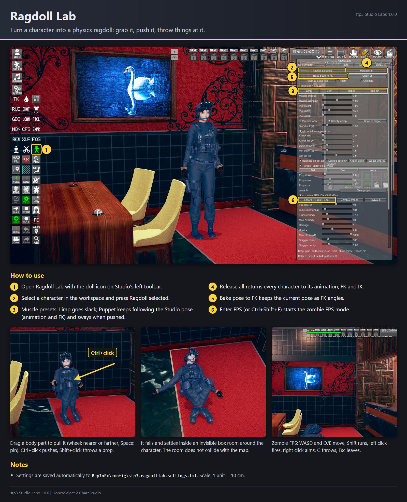
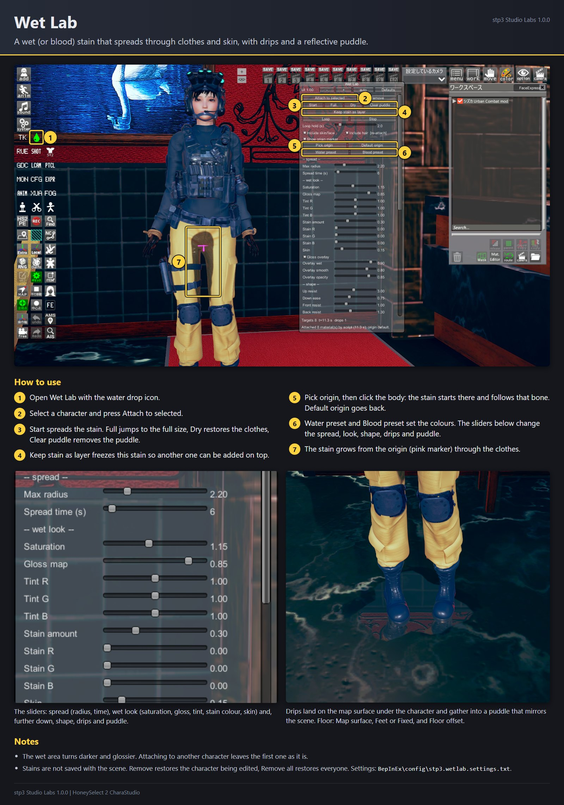
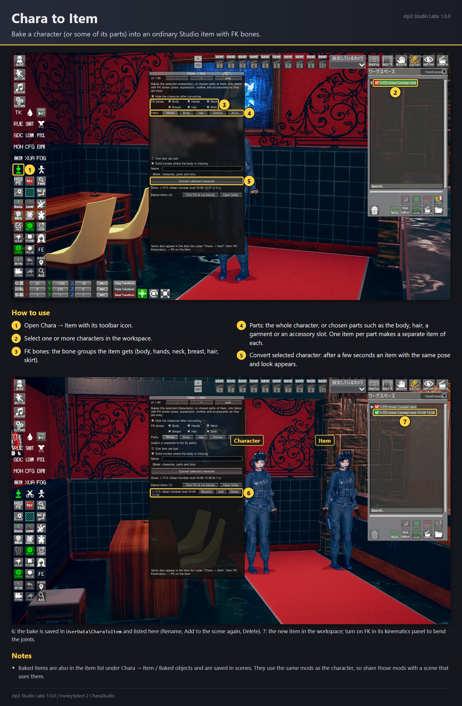
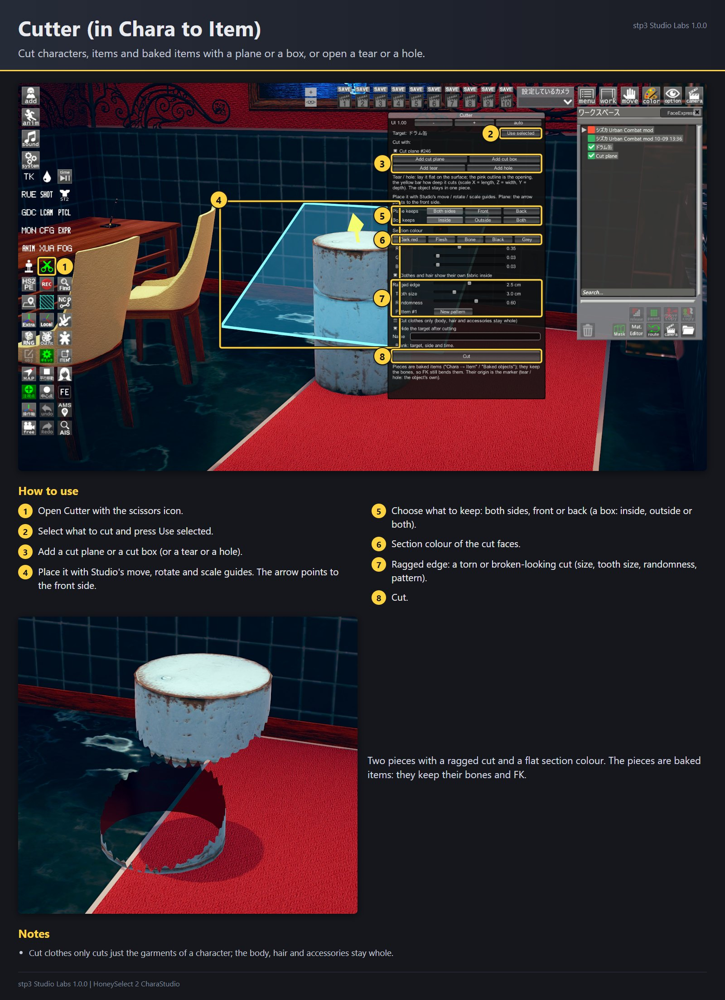
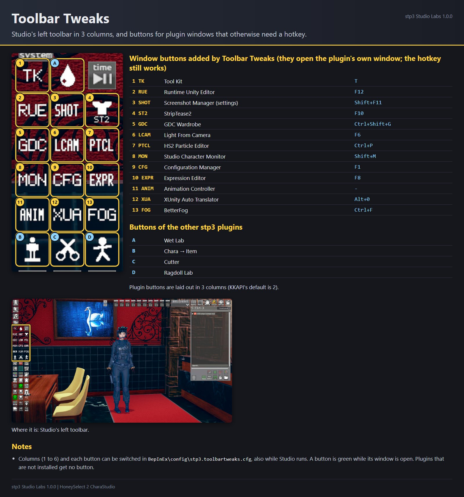
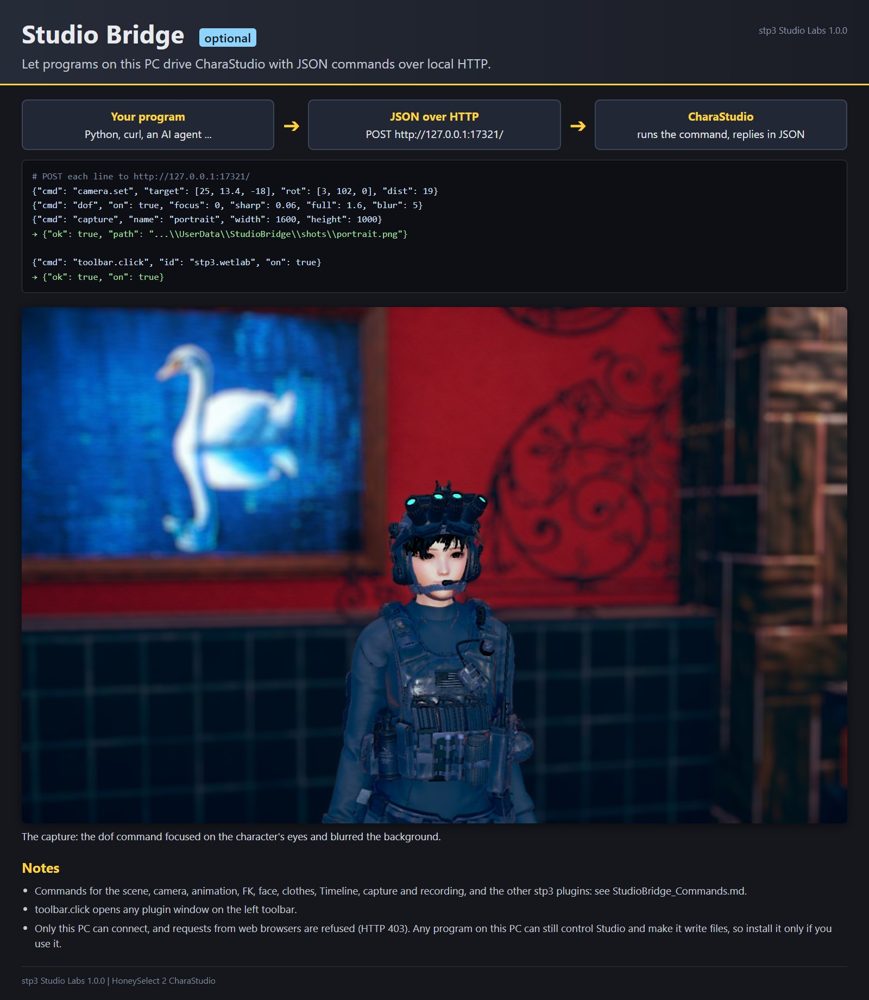
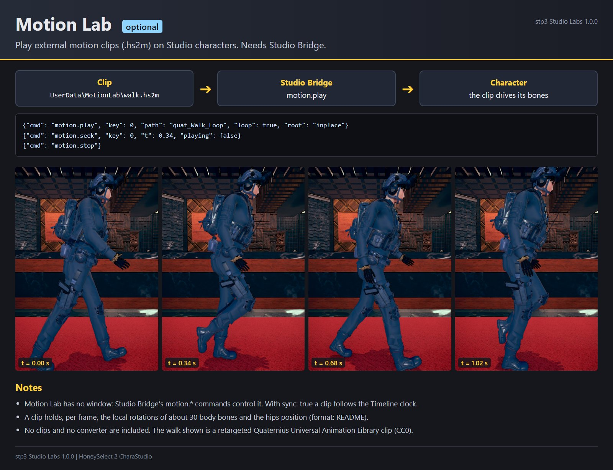

# stp3 Studio Labs 1.1.0

Plugins for HoneySelect 2 CharaStudio. Each one is a separate DLL, so you can remove the ones you do not want.
All of them work in CharaStudio only (not in the main game or the character maker).
Illustrated guides for each plugin are in `guides\en\` (Japanese: `guides\ja\`, Simplified Chinese: `guides\zh-Hans\`).

| Plugin | DLL | Version | What it does | Opened from |
| --- | --- | --- | --- | --- |
| Ragdoll Lab | HS2_RagdollLab.dll | 1.1.0 | Turns a character into a physics ragdoll you can grab, push and throw things at, with a zombie FPS mode | toolbar, doll icon |
| Wet Lab | HS2_WetLab.dll | 1.1.0 | A wet (or blood) stain that spreads through clothes and skin, with drips and a reflective floor puddle | toolbar, water drop icon |
| Chara to Item | HS2_CharaToItem.dll | 1.1.0 | Bakes a character (or some of its parts) into an ordinary Studio item with FK bones; Cutter cuts characters and items with a plane, a box, a tear or a hole | toolbar, "Chara → Item" and scissors icons |
| Toolbar Tweaks (optional) | HS2_ToolbarTweaks.dll | 1.0.0 | Lays the left toolbar out in 3 columns and adds buttons for plugin windows that only open with a hotkey | (config file) |
| Studio Bridge (optional) | HS2_StudioBridge.dll | 1.1.0 | Lets programs on this PC drive Studio through a local HTTP/JSON interface | (no window) |
| Motion Lab (optional) | HS2_MotionLab.dll | 1.0.0 | Plays motion clips (.hs2m) on characters; driven through Studio Bridge | (no window) |

## Requirements

- BepInEx 5.4 and HS2API (KKAPI / Modding API) 1.48 or newer. Repacks such as BetterRepack include both.
- Chara to Item also uses Sideloader and Material Editor when they are installed (both are in the usual mod packs).
- Studio Bridge uses Timeline for its `timeline.*` commands and the "Depth of Field" Timeline item; Motion Lab uses
  Timeline to follow the Timeline clock.

Tested with HoneySelect 2 DX BetterRepack R16 (BepInEx 5.4.23.5, Modding API 1.48, Sideloader 21.1.4,
Material Editor 5.0, Timeline 1.5.6), at 3840 × 2400 full screen and 1920 × 1080 in a window.

## Install

1. Extract the `BepInEx` folder of the ZIP into the game folder (the folder with `StudioNEOV2.exe`).
   The plugins end up in `BepInEx\plugins\stp3\`.
2. Optional, the same way:
   - `Optional\ToolbarTweaks\BepInEx` for Toolbar Tweaks (it relies on HS2API's internals; see below).
   - `Optional\StudioBridge\BepInEx` for Studio Bridge and Motion Lab. Read "Studio Bridge" below first.

If you used the C# Script Loader versions of these plugins (`scripts\RagdollLab.cs`, `scripts\WetLab.cs` and so
on), remove them. While a script copy is installed, the matching DLL stays off and writes a warning to the BepInEx
log, so the same plugin does not run twice. An older `WetLab.dll` in `BepInEx\plugins` keeps this Wet Lab from
loading (the BepInEx log says so); delete it.

Uninstall: delete `BepInEx\plugins\stp3\`. What the plugins wrote is listed under "Files" below.

## Ragdoll Lab

Select a character in the workspace, open Ragdoll Lab and press **Ragdoll selected**.

- Drag a body part to grab and pull it. While dragging, the mouse wheel moves it nearer or farther and Space pins
  it in place ("Unpin all" frees it).
- Pins can follow a Studio object, for example an empty item you also use as an IK target: select the object,
  then while dragging press **T**. The part is pulled along wherever the object goes (moved by hand, Timeline or
  NodesConstraints). A pinned part's row in the window has **Follow selected**, **Stay** and **Unpin**; "Follow
  pin stiff" and "Follow pin max" (simulation section) set how firmly it follows.
- While dragging, **N** makes a Studio folder named "RL <character> <part>" that copies the part's position and
  rotation every frame. Parent items under it, or use it as a NodesConstraints parent, to make them move with the
  ragdoll. After the ragdoll is released the folder stays where it was.
- Ctrl+click pushes, Shift+click throws a prop (size, mass and speed are in the window).
- **Release all** returns every character to its animation, FK and IK. **Bake pose to FK** keeps the current pose
  as FK angles.
- Limp, Stiff, Puppet and Hips pin are muscle presets. Puppet follows the Studio pose (animation and FK), so an
  animated character keeps moving and reacts to pushes. Characters in IK mode follow the pose they had when ragdolled.
- The physics runs in an invisible box room around the character ("Room at selection" moves it there). Its size
  is set with Room W, H and D at the bottom of the window (default 40 × 30 × 40 units, that is 4 × 3 × 4 m; up to
  20 × 10 × 20 m); the room is rebuilt in place as soon as a slider stops moving. "Room" shows its outline.
  It does not collide with the map.
- Zombie FPS mode: **Enter FPS** or Ctrl+Shift+F. WASD and Q/E move, Shift runs, the left mouse button fires,
  the right one aims, G throws a prop, Esc or Ctrl+Shift+F leaves. Bullets pass through bodies; hits stagger and
  knock characters down, and at zero HP they go limp until they revive ("Revive all", "Zombie preset").
- Scale: 1 unit = 10 cm, so the default gravity is 98.1.

## Wet Lab

Select a character, open Wet Lab and press **Attach to selected**, then **Start**.

- The stain spreads from the origin, by default the surface of the clothes in front of the crotch. **Pick origin**
  sets another origin by clicking the body (it follows that bone); **Default origin** goes back.
- **Full** jumps to the full size, **Dry** restores the clothes, **Loop** repeats the spread, **Clear puddle**
  removes the puddle. **Water preset** and **Blood preset** set the colours.
- Sliders: how far and how fast it spreads, the wet look (stain colour, saturation, gloss, skin), the shape
  (resistance upward, sideways, toward the outer thighs; edge noise), drips and the puddle (colour, opacity, shine,
  edge, size, mirror reflection).
- Floor: drips and the puddle land on the map surface below the character ("Map surface", default), at the feet
  ("Feet") or at a fixed height ("Fixed"). "Floor offset" moves it up or down.
- The **def** button beside each slider puts that setting back to its default; it is greyed out while the
  setting is at the default. **Defaults** at the top resets all of them.
- **Keep stain as layer** freezes the current stain so another one (blood over water, for example) can be added.
- Several characters: attaching to a second character keeps the first one as it is; select it and attach again
  to edit it. **Remove** restores the character being edited, **Remove all** restores everyone.
- Stains are not saved with the scene.

## Chara to Item

Open **Chara → Item**, select a character and press **Convert selected character**. After a few seconds an item
with the same pose and look appears; the character is hidden (not deleted) if "Hide the character after
converting" is on.

- Turn on FK in the item's kinematics panel to bend its joints; the FK bones are those of a Studio character.
  "FK bones" chooses which groups the item gets (body, hands, neck, breast, hair, skirt).
- "Parts" converts only some parts: body, head, each hair slot, each of the 8 garments, each accessory slot, or
  presets (Body, Hair, Clothes, Accs). "One item per part" makes a separate item of each.
  The item origin of converted parts is at their centre of mass (turn off "Item origin at the parts' centre" to
  keep the character's).
- Baked items are kept in `UserData\CharaToItem` and listed under the item group "Chara → Item", category
  "Baked objects", so they can be added again later and are saved in scenes like any item. The window's list
  renames and deletes them.
- A baked item refers to the same mods as the character (clothes, hair, textures). Without those mods, or without
  its files in `UserData\CharaToItem`, it cannot be loaded. To share a scene that uses baked items, share those
  files and the mods too.
- Deleting a bake from the window also deletes the textures in `UserData\CharaToItem\textures` that no remaining
  bake uses. Do not move bake files (`.c2i`) out of the folder and delete others in the meantime: the textures of
  the moved ones would be deleted too.

### Cutter

Cutter (scissors icon) cuts characters, items and baked items:

1. Select the target and press **Use selected**.
2. Add a **cut plane** or a **cut box** and place it with Studio's move, rotate and scale guides.
   **Add tear** and **Add hole** open a tear or a hole in a surface instead of cutting it apart.
3. Choose what to keep (both sides, front or back; inside, outside or both) and press **Cut**.

Pieces keep their bones, and FK only for the bones that still move something in them (a piece of a long rope
gets FK along the piece, not along the part cut away). The section colour (dark red by default), a ragged edge (size, tooth size,
randomness, pattern) and "Cut clothes only" are in the window. A piece has one section colour: cutting it again
with another colour recolours its earlier cuts too.

Item numbers used: group 731406, baked items 73100001 and up, cut tools 73099001 to 73099004.

## Toolbar Tweaks

Optional (`Optional\ToolbarTweaks`): it changes how HS2API lays out the toolbar, so an HS2API update can stop it
from working.

- Plugin buttons on the Studio left toolbar are laid out in 3 columns instead of 2 (`Columns`, 1 to 6, in
  `BepInEx\config\stp3.toolbartweaks.cfg`; changes apply while Studio runs). Buttons placed with KKAPI's
  toolbar edit mode keep their position.
- Buttons for windows that otherwise need a hotkey: StripTease2 (ziglo), Configuration Manager, Animation
  Controller, HS2 Particle Editor, Light From Camera, Tool Kit, BetterFog (ziglo), Studio Character Monitor,
  GDC Wardrobe, Screenshot Manager settings, Expression Editor (arg0x), Runtime Unity Editor and XUnity Auto
  Translator. A button is green while its window is open. Plugins that are not installed get no button; turn
  buttons off in the `[Buttons]` section of the config file.
- The column change relies on how HS2API 1.48 lays out the toolbar. If a later version changes that, the
  columns stay as they are and the BepInEx log says so.

## Studio Bridge (optional)

Studio Bridge listens on `http://127.0.0.1:17321/`. POST a JSON object with a `cmd` and its arguments; the command
runs on Studio's main thread and the reply is JSON (`{"ok": true, ...}` or `{"ok": false, "error": "..."}`).

    curl -s -X POST http://127.0.0.1:17321/ -d "{\"cmd\":\"scene\"}"

Only programs on this PC can connect, and requests from web browsers are refused (a web page could otherwise send
commands to it). Any program on this PC can, however, control Studio and make it read and write files (captures,
mesh exports, coordinate cards), so install it only if you use it.

There are commands for the scene and objects, maps, animation, poses, FK and IK, the face, hands, clothes and
accessories, the camera, captures and recording, depth of field, Timeline, the toolbar (`toolbar.click` opens any
plugin window) and the other stp3 plugins. Every command and its arguments: `StudioBridge_Commands.md`.
For an AI agent (Claude Code, Codex and the like), point it to `AGENTS.md` in the same folder: how to check the
bridge, call it, set up a first scene, and work without disturbing yours.

## Motion Lab (optional)

Motion Lab plays `.hs2m` clips on Studio characters. It has no window; Studio Bridge's `motion.load`,
`motion.play`, `motion.pause`, `motion.seek`, `motion.speed`, `motion.stop` and `motion.status` control it.
Clips are read from `UserData\MotionLab\` (a bare name is enough). `motion.play` with `sync: true` follows the
Timeline clock; `root` chooses how the hips move (`full`, `inplace`, `y`, `none`).

No clips and no converter are included. A clip is retargeted motion for the HS2 skeleton:

    "HS2M", int32 version (1), float32 fps, int32 frames, int32 bones,
    bones × (1 byte length + UTF-8 bone name, e.g. cf_J_Hips),
    frames × 3 float32: hips position (character object space, 1 unit = 10 cm),
    frames × bones × 4 float32: local rotation (x, y, z, w) of each bone

Rotations are local rotations in Unity's left-handed frame of the HS2 body skeleton (`cf_J_*`), whose bind pose is
a T pose (arms horizontal, legs straight down, facing +Z).

## How the plugins work together

| Plugin | Needs | Uses when present |
| --- | --- | --- |
| Ragdoll Lab | HS2API | Motion Lab (a ragdoll follows a playing motion clip) |
| Wet Lab | HS2API | |
| Chara to Item | HS2API | Sideloader (keeps its own item numbers out of Sideloader's ID resolving), Material Editor (shader copies and property list) |
| Toolbar Tweaks | HS2API 1.48 layout | the 13 plugins listed above |
| Studio Bridge | HS2API | Timeline; Ragdoll Lab, Wet Lab, Motion Lab, Chara to Item and Toolbar Tweaks through its commands |
| Motion Lab | Studio Bridge | Timeline |

Each plugin works without the others, except Motion Lab, which is controlled only through Studio Bridge.
Ragdoll Lab and Motion Lab both write bone rotations after the animation; Motion Lab writes first, so a ragdoll's
target pose is the motion clip.

## Files

| Where | What |
| --- | --- |
| `BepInEx\config\stp3.ragdolllab.settings.txt`, `stp3.wetlab.settings.txt` | window settings, saved automatically |
| `BepInEx\config\stp3.toolbartweaks.cfg` | columns and buttons |
| `UserData\CharaToItem\` | baked items (`.c2i`), their textures (`textures\*.c2t`), the last item number used |
| `UserData\StudioBridge\` | captures, recordings and exported meshes (Studio Bridge) |
| `UserData\MotionLab\` | motion clips (`.hs2m`) |

## Known limitations

- Tested on one HoneySelect 2 setup (listed above). Other mod combinations may behave differently.
- Ragdoll Lab's physics does not see the map; Wet Lab finds the floor from the map's meshes.
- Toolbar Tweaks depends on internal details of HS2API 1.48 and of the plugins it adds buttons for.

## Terms

The code of these plugins was written by stp3, who releases it into the public domain: use, change and share it
freely. This does not extend to HoneySelect 2, its assets or other people's mods: what you make from them with
these plugins (baked items, edited textures, captures) stays under their owners' terms.

stp3
