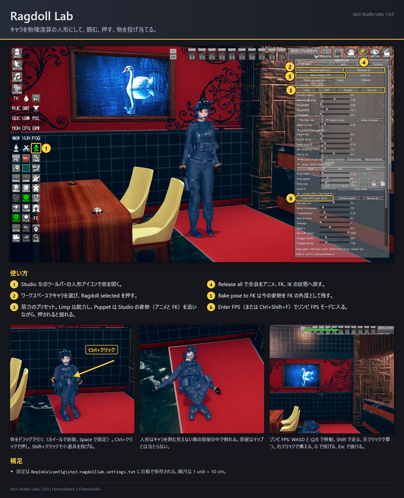
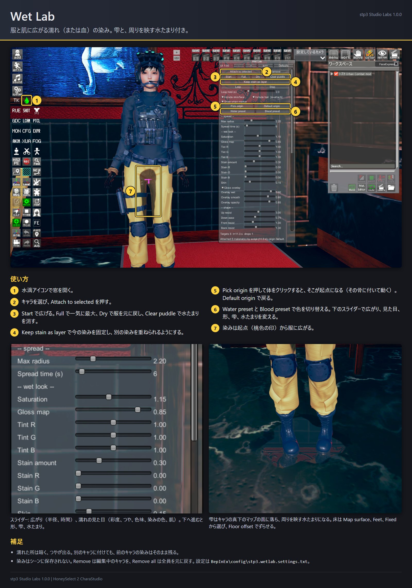
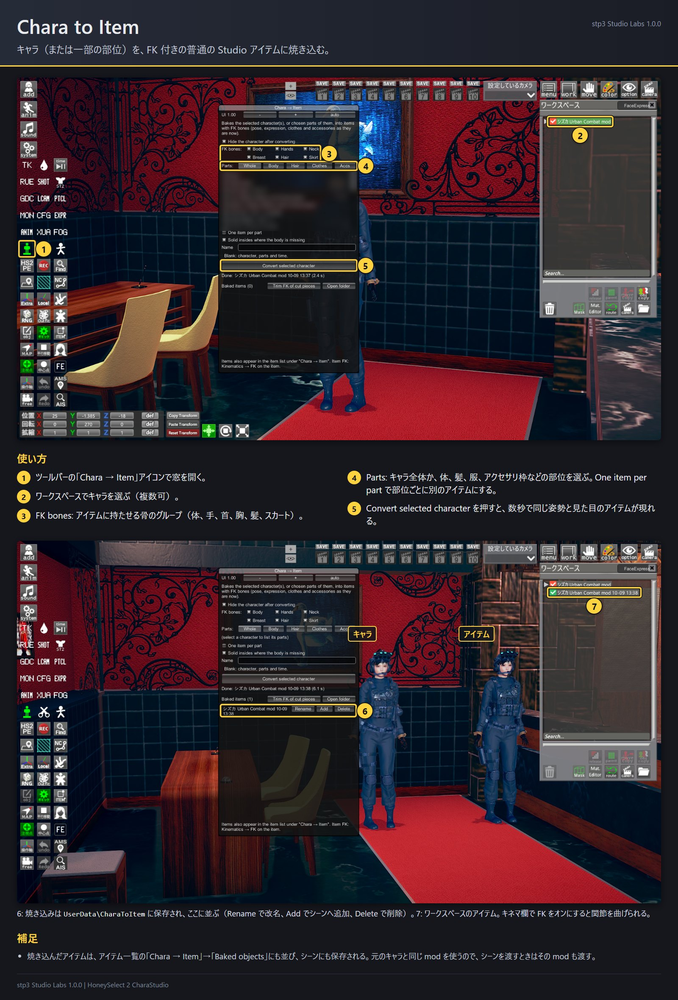
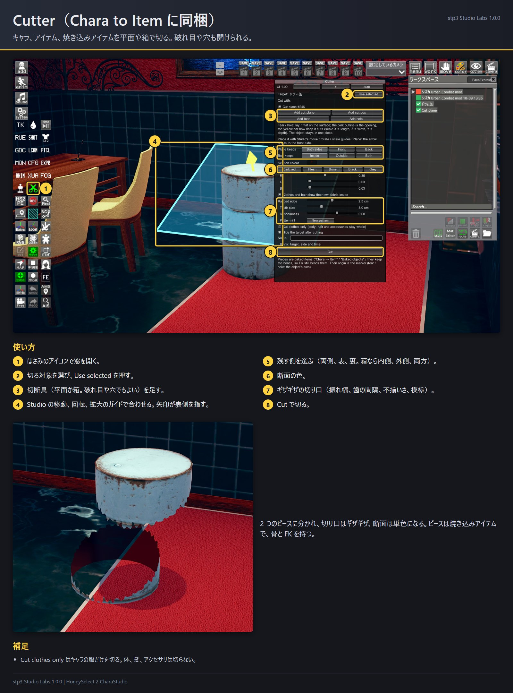
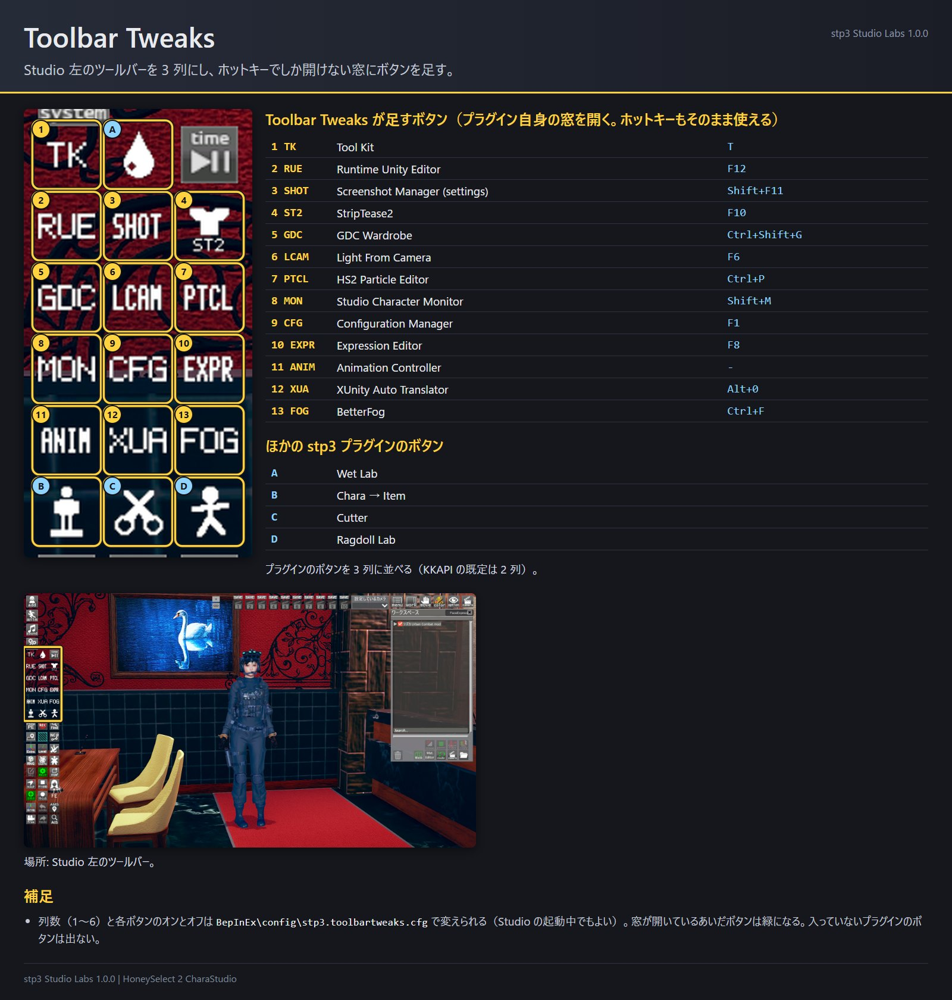
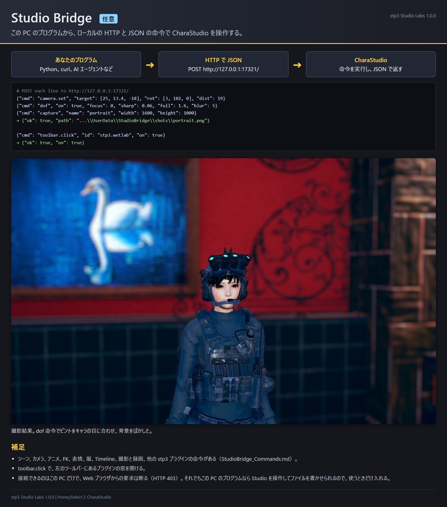
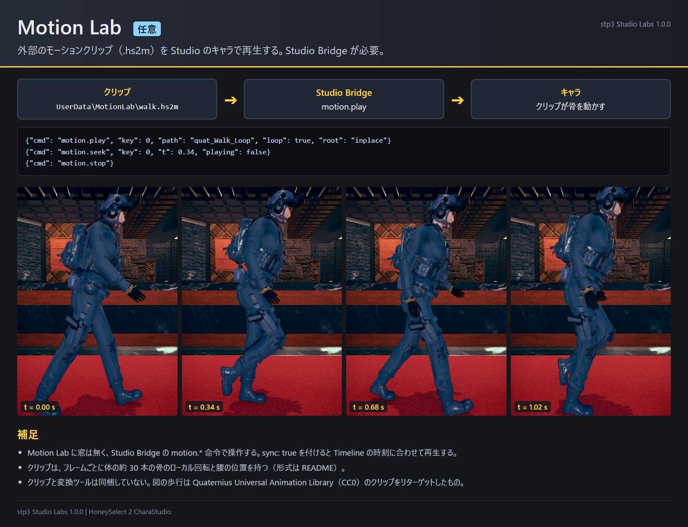

# stp3 Studio Labs 1.1.0

HoneySelect 2 の CharaStudio 用プラグイン集です。プラグインごとに DLL が分かれているので、要らないものは消せます。
どれも CharaStudio 専用で、本編とキャラメイクでは動きません。
プラグインごとの図解は `guides\ja\` にあります（英語は `guides\en\`、簡体字中国語は `guides\zh-Hans\`）。

| プラグイン | DLL | 版 | できること | 開き方 |
| --- | --- | --- | --- | --- |
| Ragdoll Lab | HS2_RagdollLab.dll | 1.1.0 | キャラを物理演算の人形（ラグドール）にして、掴む、押す、物を投げ当てる。ゾンビ FPS モード付き | ツールバーの人形アイコン |
| Wet Lab | HS2_WetLab.dll | 1.1.0 | 服と肌に広がる濡れ（または血）の染み。雫と、周りを映す床の水たまり付き | ツールバーの水滴アイコン |
| Chara to Item | HS2_CharaToItem.dll | 1.1.0 | キャラ（または一部の部位）を FK 付きの普通の Studio アイテムに焼き込む。Cutter はキャラやアイテムを平面、箱、破れ目、穴で切る | ツールバーの「Chara → Item」とはさみのアイコン |
| Toolbar Tweaks（任意） | HS2_ToolbarTweaks.dll | 1.0.0 | 左のツールバーを 3 列にし、ホットキーでしか開けないプラグインの窓にボタンを足す | （設定ファイル） |
| Studio Bridge（任意） | HS2_StudioBridge.dll | 1.1.0 | この PC のプログラムから、ローカルの HTTP と JSON で Studio を操作する | （窓なし） |
| Motion Lab（任意） | HS2_MotionLab.dll | 1.0.0 | モーションクリップ（.hs2m）をキャラで再生する。Studio Bridge から操作する | （窓なし） |

## 必要なもの

- BepInEx 5.4 と HS2API（KKAPI、Modding API）1.48 以降。BetterRepack などのリパックには両方入っています。
- Chara to Item は、Sideloader と Material Editor が入っていればそれも使います（通常の mod 一式に入っています）。
- Studio Bridge は `timeline.*` 命令と Timeline の「Depth of Field」項目に Timeline を使います。Motion Lab は Timeline の時刻に合わせるときに使います。

確認した環境: HoneySelect 2 DX BetterRepack R16（BepInEx 5.4.23.5、Modding API 1.48、Sideloader 21.1.4、Material Editor 5.0、Timeline 1.5.6）。画面は 3840 × 2400 の全画面と、1920 × 1080 のウィンドウ表示。

## 導入

1. ZIP の `BepInEx` フォルダを、ゲームのフォルダ（`StudioNEOV2.exe` があるフォルダ）へ展開します。プラグインは `BepInEx\plugins\stp3\` に入ります。
2. 任意で、同じようにゲームのフォルダへ展開します。
   - Toolbar Tweaks は `Optional\ToolbarTweaks\BepInEx`（HS2API の内部に依存します。下を参照）。
   - Studio Bridge と Motion Lab は `Optional\StudioBridge\BepInEx`。先に下の「Studio Bridge」を読んでください。

これらのプラグインの C# Script Loader 版（`scripts\RagdollLab.cs`、`scripts\WetLab.cs` など）を使っていたら、それを外してください。スクリプト版が入っているあいだ、対応する DLL は動かず、BepInEx のログに警告を出します。同じプラグインが二重に動かないようにするためです。`BepInEx\plugins` に古い `WetLab.dll` があると、この Wet Lab は読み込まれません（BepInEx のログに理由が出ます）。古い方を消してください。

削除: `BepInEx\plugins\stp3\` を消します。プラグインが書いたファイルは下の「ファイル」の表にあります。

## Ragdoll Lab

ワークスペースでキャラを選び、Ragdoll Lab の窓で **Ragdoll selected** を押します。

- 体の部分をドラッグすると、掴んで引けます。ドラッグ中にホイールで手前と奥へ動かし、Space でその場に留めます（「Unpin all」で外す）。
- ピンは Studio のオブジェクトに付いて行かせることもできます。たとえば IK のターゲットに使っている空アイテムを選んでから、ドラッグ中に **T** を押します。そのオブジェクトを手で動かしても、Timeline や NodesConstraints で動かしても、部位が引っぱられて付いて行きます。窓のピンの行には **Follow selected**、**Stay**、**Unpin** があり、付いて行く強さは「Follow pin stiff」と「Follow pin max」（シミュレーション欄）で決めます。
- ドラッグ中に **N** を押すと、その部位の位置と向きを毎フレーム写す Studio のフォルダー「RL <キャラ> <部位>」ができます。アイテムをその下に入れるか NodesConstraints の親にすると、ラグドールと一緒に動きます。ラグドールを解除した後は、その場に残ります。
- Ctrl+クリックで押し、Shift+クリックで小道具を投げます（大きさ、重さ、速さは窓で変えられます）。
- **Release all** で全員をアニメ、FK、IK の状態へ戻します。**Bake pose to FK** は今の姿勢を FK の角度として残します。
- Limp、Stiff、Puppet、Hips pin は筋力のプリセットです。Puppet は Studio の姿勢（アニメと FK）を追うので、アニメ再生中のキャラは動き続けながら、押されると揺れます。IK モードのキャラは、人形にした時点の姿勢を追います。
- 物理はキャラを囲む見えない箱の部屋の中で計算します（「Room at selection」で部屋をそこへ動かします）。部屋の大きさは窓のいちばん下の Room W、H、D で変えられ（既定は 40 × 30 × 40 unit、つまり 4 × 3 × 4 m。最大 20 × 10 × 20 m）、スライダーを止めるとその場で部屋を作り直します。「Room」にチェックを入れると部屋の枠が見えます。マップとは当たりません。
- ゾンビ FPS モード: **Enter FPS** か Ctrl+Shift+F で入ります。WASD と Q/E で移動、Shift で走り、左クリックで撃ち、右クリックで構え、G で小道具を投げ、Esc か Ctrl+Shift+F で抜けます。弾は体を貫通し、当たるとよろけて倒れ、HP が 0 になると力が抜けて、しばらくすると起き上がります（「Revive all」「Zombie preset」）。
- 縮尺は 1 unit = 10 cm なので、重力の既定値は 98.1 です。

## Wet Lab

キャラを選び、Wet Lab の窓で **Attach to selected**、続けて **Start** を押します。

- 染みは起点から広がります。既定の起点は、股の前の服の表面です。**Pick origin** を押して体をクリックすると起点を変えられ（その骨に付いて動きます）、**Default origin** で戻ります。
- **Full** で一気に最大まで広げ、**Dry** で服を元に戻し、**Loop** で広がりを繰り返し、**Clear puddle** で水たまりを消します。**Water preset** と **Blood preset** は色の組み合わせです。
- スライダーで変えられるもの: 広がる範囲と速さ、濡れの見た目（染みの色、彩度、つや、肌）、形（上、横、外ももへの広がりにくさ、縁の乱れ）、雫と水たまり（色、不透明度、つや、縁、大きさ、鏡の映り込み）。
- 床: 雫と水たまりは、キャラの真下のマップの面（「Map surface」、既定）、足元（「Feet」）、固定の高さ（「Fixed」）のどれかに落ちます。「Floor offset」で上下にずらせます。
- 各スライダーの右の **def** は、その設定だけを既定値に戻します（既定値のときは灰色）。上の **Defaults** は全部を戻します。
- **Keep stain as layer** は今の染みを固定して、別の染みを重ねられるようにします（水の上に血、など）。
- 複数のキャラ: 2 人目に付けても 1 人目はそのまま残ります。1 人目を選んでもう一度 Attach すると、編集に戻ります。**Remove** は編集中のキャラを、**Remove all** は全員を元に戻します。
- 染みはシーンに保存されません。

## Chara to Item

**Chara → Item** の窓を開き、キャラを選んで **Convert selected character** を押します。数秒で同じ姿勢と見た目のアイテムが現れます。「Hide the character after converting」がオンなら、元のキャラは非表示になります（削除はしません）。

- アイテムのキネマ欄で FK をオンにすると、関節を曲げられます。FK の骨は Studio のキャラ FK と同じです。「FK bones」で、アイテムに持たせる骨のグループ（体、手、首、胸、髪、スカート）を選べます。
- 「Parts」で一部の部位だけを変換できます。体、頭部、髪の各枠、服 8 種、アクセサリの各枠と、プリセット（Body、Hair、Clothes、Accs）があります。「One item per part」をオンにすると、部位ごとに別のアイテムになります。部位を変換したアイテムの原点はその部位の重心です（「Item origin at the parts' centre」をオフにするとキャラの原点のまま）。
- 焼き込んだアイテムは `UserData\CharaToItem` に保存され、アイテム一覧のグループ「Chara → Item」、カテゴリ「Baked objects」に並びます。後からまた追加でき、シーンにも普通のアイテムとして保存されます。窓の一覧で名前の変更と削除ができます。
- 焼き込んだアイテムは、元のキャラと同じ mod（服、髪、テクスチャ）を参照します。その mod が無いか、`UserData\CharaToItem` のファイルが無いと読み込めません。焼き込みアイテムを使ったシーンを人に渡すときは、そのファイルと mod も渡してください。
- 窓で焼き込みを削除すると、残っているどの焼き込みも使っていないテクスチャ（`UserData\CharaToItem\textures`）も一緒に消えます。焼き込みファイル（`.c2i`）をフォルダの外へ移したまま別の焼き込みを削除しないでください。移した焼き込みのテクスチャまで消えます。

### Cutter

Cutter（はさみのアイコン）は、キャラ、アイテム、焼き込んだアイテムを切ります。

1. 切る対象を選び、**Use selected** を押します。
2. **cut plane**（平面）か **cut box**（箱）を足し、Studio の移動、回転、拡大のガイドで合わせます。切り離さずに表面へ破れ目や穴を開けるときは **Add tear**、**Add hole** を使います。
3. 残す側（両側、表、裏。箱なら内側、外側、両方）を選び、**Cut** を押します。

切ったピースも骨を持ち、FK はピースに残った部分を動かす骨にだけ付きます（長い縄から切り出したピースなら、切り落とした側には FK が並びません）。断面の色（既定は暗い赤）、ギザギザの切り口（振れ幅、歯の間隔、不揃いさ、模様）、「Cut clothes only」は窓で選べます。断面の色はピース 1 つにつき 1 色で、別の色で切り直すと前の切り口もその色になります。

使うアイテム番号: グループ 731406、焼き込みアイテム 73100001 から、切断具 73099001 から 73099004。

## Toolbar Tweaks

任意（`Optional\ToolbarTweaks`）です。HS2API のツールバーの並べ方に手を入れるので、HS2API の更新で効かなくなることがあります。

- Studio 左のツールバーのプラグインボタンを、2 列ではなく 3 列に並べます。列数は `BepInEx\config\stp3.toolbartweaks.cfg` の `Columns`（1 から 6）で、Studio の起動中に変えても並び直します。KKAPI のツールバー編集モードで置いたボタンは、その位置のままです。
- ホットキーでしか開けない窓にボタンを足します。対象は StripTease2（ziglo）、Configuration Manager、Animation Controller、HS2 Particle Editor、Light From Camera、Tool Kit、BetterFog（ziglo）、Studio Character Monitor、GDC Wardrobe、Screenshot Manager の設定、Expression Editor（arg0x）、Runtime Unity Editor、XUnity Auto Translator です。窓が開いているあいだボタンは緑になります。入っていないプラグインのボタンは出ません。要らないボタンは設定ファイルの `[Buttons]` でオフにします。
- 列数の変更は HS2API 1.48 のツールバーの並べ方に依存します。後の版でそこが変わると列数はそのままになり、BepInEx のログにそう出ます。

## Studio Bridge（任意）

Studio Bridge は `http://127.0.0.1:17321/` で待ち受けます。`cmd` と引数を持つ JSON を POST すると、命令を Studio のメインスレッドで実行し、JSON（`{"ok": true, ...}` か `{"ok": false, "error": "..."}`）で返します。

    curl -s -X POST http://127.0.0.1:17321/ -d "{\"cmd\":\"scene\"}"

接続できるのはこの PC のプログラムだけで、Web ブラウザからの要求は断ります（断らないと、閲覧中の Web ページから命令を送れてしまうため）。ただし、この PC のプログラムなら何でも Studio を操作でき、ファイルの読み書き（撮影、メッシュの書き出し、コーデカード）もさせられます。使うときだけ入れてください。

命令は、シーンとオブジェクト、マップ、アニメ、ポーズ、FK と IK、表情、手、服、アクセサリ、カメラ、撮影と録画、被写界深度、Timeline、ツールバー（`toolbar.click` でプラグインの窓を開ける）、他の stp3 プラグインの操作にわたります。全命令と引数は `StudioBridge_Commands.md`（英語）にあります。AI エージェント（Claude Code、Codex など）に使わせるときは、同じフォルダの `AGENTS.md`（英語）を読ませてください。接続の確認、呼び出し方、最初の場面の組み方、ユーザーの作業を壊さないための注意が書いてあります。

## Motion Lab（任意）

Motion Lab は `.hs2m` クリップを Studio のキャラで再生します。窓は無く、Studio Bridge の `motion.load`、`motion.play`、`motion.pause`、`motion.seek`、`motion.speed`、`motion.stop`、`motion.status` で操作します。クリップは `UserData\MotionLab\` から読みます（名前だけで指定できます）。`motion.play` に `sync: true` を付けると Timeline の時刻に合わせて再生し、`root` で腰の動かし方（`full`、`inplace`、`y`、`none`）を選べます。

クリップと変換ツールは同梱していません。クリップは HS2 の骨格へリターゲットしたモーションで、形式は次のとおりです。

    "HS2M", int32 版 (1), float32 fps, int32 フレーム数, int32 骨数,
    骨数 × (長さ 1 byte + UTF-8 の骨名。例 cf_J_Hips),
    フレーム数 × 3 float32: 腰の位置（キャラのオブジェクト座標、1 unit = 10 cm）,
    フレーム数 × 骨数 × 4 float32: 各骨のローカル回転 (x, y, z, w)

回転は、HS2 の体の骨格（`cf_J_*`）の Unity 左手系でのローカル回転です。骨格の基準姿勢は T ポーズ（腕は水平、脚はまっすぐ下、+Z 向き）です。

## プラグイン同士の関係

| プラグイン | 必要 | あれば使う |
| --- | --- | --- |
| Ragdoll Lab | HS2API | Motion Lab（再生中のモーションを人形が追う） |
| Wet Lab | HS2API | |
| Chara to Item | HS2API | Sideloader（自分のアイテム番号を Sideloader の ID 解決から外す）、Material Editor（シェーダーの共有コピーとプロパティ一覧） |
| Toolbar Tweaks | HS2API 1.48 の並べ方 | 上に挙げた 13 のプラグイン |
| Studio Bridge | HS2API | Timeline。命令を通して Ragdoll Lab、Wet Lab、Motion Lab、Chara to Item、Toolbar Tweaks |
| Motion Lab | Studio Bridge | Timeline |

Motion Lab は Studio Bridge からしか操作できないので Studio Bridge が要ります。それ以外は、どのプラグインも単独で動きます。
Ragdoll Lab と Motion Lab は、どちらもアニメの後で骨の回転を書きます。Motion Lab が先に書くので、人形が目標にする姿勢はモーションクリップの姿勢になります。

## ファイル

| 場所 | 中身 |
| --- | --- |
| `BepInEx\config\stp3.ragdolllab.settings.txt`、`stp3.wetlab.settings.txt` | 窓の設定（自動で保存） |
| `BepInEx\config\stp3.toolbartweaks.cfg` | 列数とボタン |
| `UserData\CharaToItem\` | 焼き込んだアイテム（`.c2i`）、そのテクスチャ（`textures\*.c2t`）、最後に使った番号 |
| `UserData\StudioBridge\` | 撮影画像、録画、書き出したメッシュ（Studio Bridge） |
| `UserData\MotionLab\` | モーションクリップ（`.hs2m`） |

## 既知の制限

- 確認したのは上に書いた HoneySelect 2 の環境 1 つだけです。mod の組み合わせが違うと、動きが変わるかもしれません。
- Ragdoll Lab の物理はマップを見ません。Wet Lab はマップのメッシュから床を探します。
- Toolbar Tweaks は、HS2API 1.48 と、ボタンを足す相手のプラグインの内部に依存します。

## 条件

これらのプラグインのコードは stp3 が書いたもので、パブリックドメインとします。自由に使い、変え、配ってかまいません。HoneySelect 2 本体とそのアセット、ほかの人の mod はこれに含まれません。それらからこのプラグインで作ったもの（焼き込みアイテム、編集したテクスチャ、撮影画像など）は、それぞれの持ち主の条件に従います。

stp3
