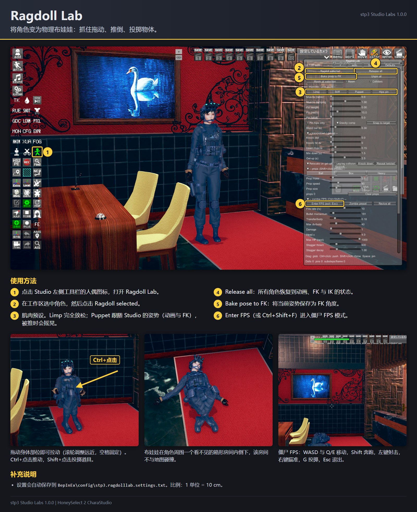
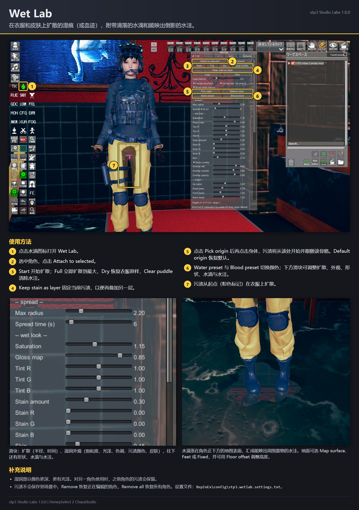
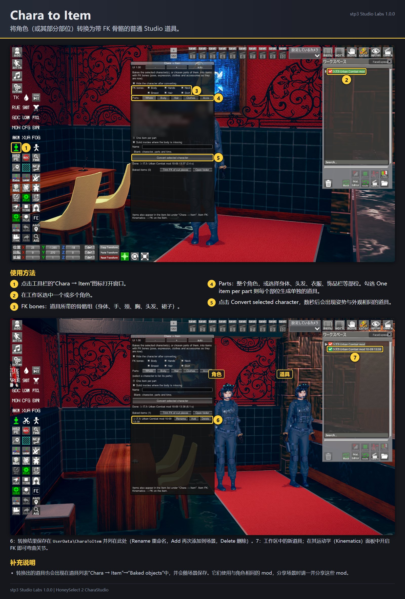
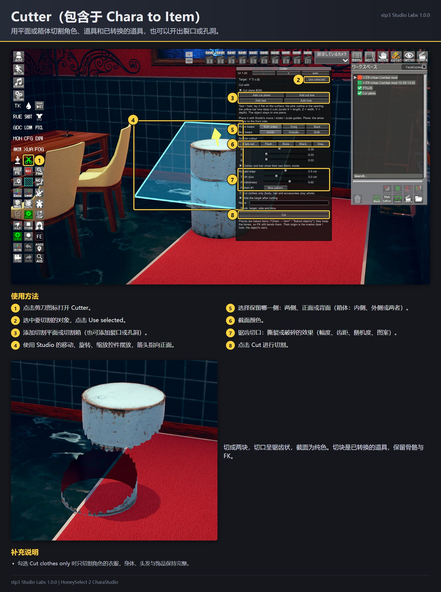
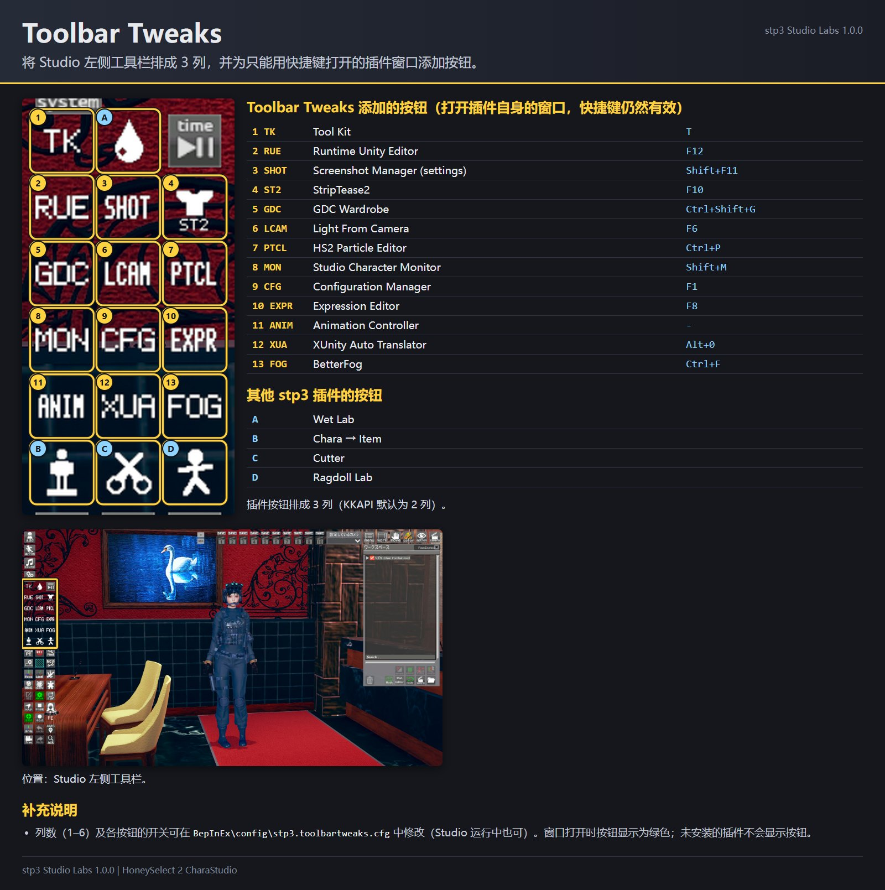
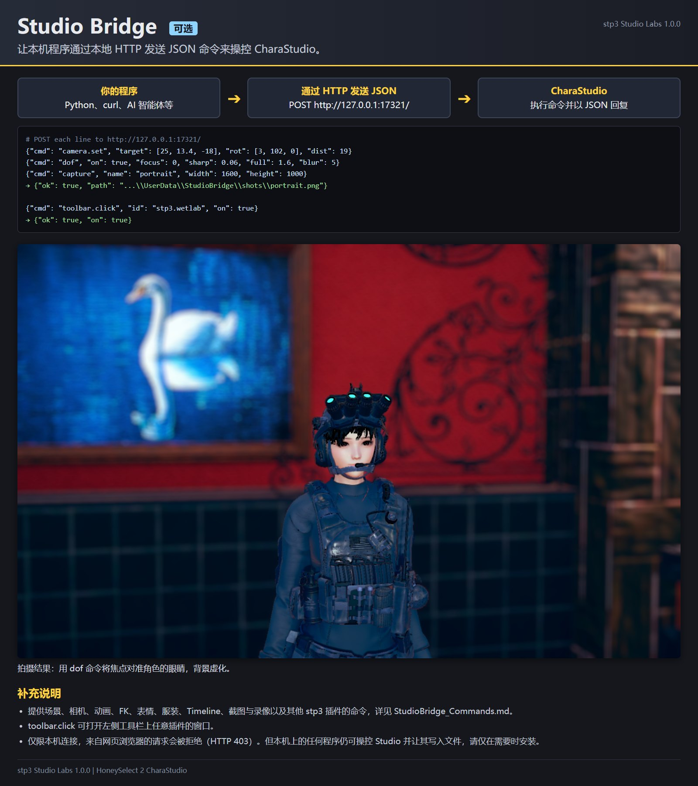
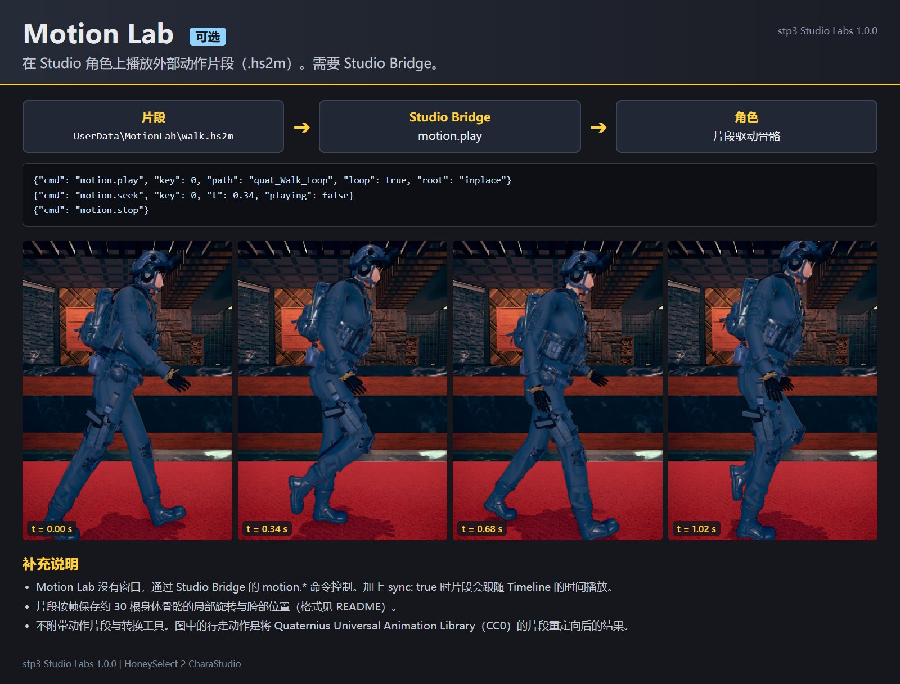

# stp3 Studio Labs 1.1.0

HoneySelect 2 CharaStudio 用插件合集。每个插件都是单独的 DLL，不需要的可以直接删除。
所有插件只在 CharaStudio 中工作（本篇游戏和角色编辑器中无效）。
各插件的图解在 `guides\zh-Hans\`（英文：`guides\en\`，日文：`guides\ja\`）。

| 插件 | DLL | 版本 | 功能 | 打开方式 |
| --- | --- | --- | --- | --- |
| Ragdoll Lab | HS2_RagdollLab.dll | 1.1.0 | 将角色变为物理布娃娃，可抓住拖动、推倒、投掷物体，附带僵尸 FPS 模式 | 工具栏的人偶图标 |
| Wet Lab | HS2_WetLab.dll | 1.1.0 | 在衣服和皮肤上扩散的湿痕（或血迹），附带滴落的水滴和能映出倒影的地面水洼 | 工具栏的水滴图标 |
| Chara to Item | HS2_CharaToItem.dll | 1.1.0 | 将角色（或其部分部位）转换为带 FK 骨骼的普通 Studio 道具；Cutter 可用平面、箱体、裂口或孔洞切割角色和道具 | 工具栏的“Chara → Item”与剪刀图标 |
| Toolbar Tweaks（可选） | HS2_ToolbarTweaks.dll | 1.0.0 | 将左侧工具栏排成 3 列，并为只能用快捷键打开的插件窗口添加按钮 | （配置文件） |
| Studio Bridge（可选） | HS2_StudioBridge.dll | 1.1.0 | 让本机程序通过本地 HTTP 与 JSON 操控 Studio | （无窗口） |
| Motion Lab（可选） | HS2_MotionLab.dll | 1.0.0 | 在角色上播放动作片段（.hs2m），通过 Studio Bridge 控制 | （无窗口） |

## 运行环境

- BepInEx 5.4 与 HS2API（KKAPI / Modding API）1.48 或更高版本。BetterRepack 等整合包已包含两者。
- 如果安装了 Sideloader 与 Material Editor，Chara to Item 也会使用它们（常见的 mod 整合包都包含）。
- Studio Bridge 的 `timeline.*` 命令和 Timeline 中的“Depth of Field”项目需要 Timeline；Motion Lab 跟随 Timeline 时间播放时也会用到 Timeline。

测试环境：HoneySelect 2 DX BetterRepack R16（BepInEx 5.4.23.5、Modding API 1.48、Sideloader 21.1.4、Material Editor 5.0、Timeline 1.5.6），分辨率 3840 × 2400 全屏与 1920 × 1080 窗口模式。

## 安装

1. 将 ZIP 中的 `BepInEx` 文件夹解压到游戏文件夹（`StudioNEOV2.exe` 所在的文件夹）。插件会放在 `BepInEx\plugins\stp3\`。
2. 可选，同样解压到游戏文件夹：
   - Toolbar Tweaks：`Optional\ToolbarTweaks\BepInEx`（依赖 HS2API 的内部实现，见下文）。
   - Studio Bridge 与 Motion Lab：`Optional\StudioBridge\BepInEx`。请先阅读下文的“Studio Bridge”。

如果你使用过这些插件的 C# Script Loader 版本（`scripts\RagdollLab.cs`、`scripts\WetLab.cs` 等），请将其移除。脚本版本存在期间，对应的 DLL 不会启动，并在 BepInEx 日志中输出警告，以免同一插件运行两次。如果 `BepInEx\plugins` 中有旧的 `WetLab.dll`，本 Wet Lab 不会被加载（BepInEx 日志会说明原因），请删除旧文件。

卸载：删除 `BepInEx\plugins\stp3\`。插件写入的文件见下文“文件”一节。

## Ragdoll Lab

在工作区选中角色，打开 Ragdoll Lab 窗口，点击 **Ragdoll selected**。

- 拖动身体部位即可抓住并拉动。拖动时用滚轮调整远近，按空格将其固定在原处（“Unpin all”解除固定）。
- 固定点也可以跟随 Studio 对象，例如用作 IK 目标的空道具：先选中该对象，拖动时按 **T**。无论用手、Timeline 还是 NodesConstraints 移动该对象，部位都会被拉着跟随。窗口中每个固定点一行，有 **Follow selected**、**Stay**、**Unpin**；跟随的强度由“Follow pin stiff”与“Follow pin max”（模拟区）设置。
- 拖动时按 **N**，会生成名为“RL <角色> <部位>”的 Studio 文件夹，每帧复制该部位的位置与旋转。把道具放到它下面，或作为 NodesConstraints 的父对象，即可随布娃娃移动。解除布娃娃后文件夹留在原处。
- Ctrl+点击推动，Shift+点击投掷道具（大小、质量、速度在窗口中设置）。
- **Release all** 让所有角色恢复到动画、FK 与 IK 的状态。**Bake pose to FK** 将当前姿势保存为 FK 角度。
- Limp、Stiff、Puppet、Hips pin 是肌肉预设。Puppet 会跟随 Studio 的姿势（动画与 FK），因此播放动画的角色会继续动作，被推时会摇晃。IK 模式的角色会跟随变为布娃娃时的姿势。
- 物理计算在角色周围一个看不见的箱形房间内进行（“Room at selection”将房间移到该处）。房间大小可在窗口最下方的 Room W、H、D 中设置（默认 40 × 30 × 40 单位，即 4 × 3 × 4 m；最大 20 × 10 × 20 m），滑块停止后会立即在原处重建房间。勾选“Room”可显示房间轮廓。房间不与地图碰撞。
- 僵尸 FPS 模式：点击 **Enter FPS** 或按 Ctrl+Shift+F 进入。WASD 与 Q/E 移动，Shift 奔跑，左键射击，右键瞄准，G 投掷道具，Esc 或 Ctrl+Shift+F 退出。子弹会穿透身体；被击中的角色会踉跄、倒地，HP 归零后会瘫软，过一段时间再站起来（“Revive all”“Zombie preset”）。
- 比例：1 单位 = 10 cm，因此重力默认值为 98.1。

## Wet Lab

选中角色，打开 Wet Lab 窗口，点击 **Attach to selected**，然后点击 **Start**。

- 污渍从起点开始扩散，默认起点是裆部前方的衣服表面。点击 **Pick origin** 后再点击身体，可以更换起点（起点会跟随该骨骼）；**Default origin** 恢复默认。
- **Full** 立即扩散到最大，**Dry** 恢复衣服原样，**Loop** 重复扩散，**Clear puddle** 清除水洼。**Water preset** 与 **Blood preset** 是颜色预设。
- 可用滑块调整：扩散范围与速度、湿润外观（污渍颜色、饱和度、光泽、皮肤）、形状（向上、向侧面、向大腿外侧扩散的难易度，边缘噪声）、水滴与水洼（颜色、不透明度、光泽、边缘、大小、镜面反射）。
- 地面：水滴与水洼落在角色正下方的地图表面（“Map surface”，默认）、脚下（“Feet”）或固定高度（“Fixed”）。“Floor offset”可上下调整。
- 每个滑块右侧的 **def** 按钮可将该项恢复为默认值（处于默认值时显示为灰色）。顶部的 **Defaults** 恢复全部设置。
- **Keep stain as layer** 固定当前污渍，以便再叠加另一层（例如在水渍上叠加血迹）。
- 多个角色：对第二个角色使用时，第一个角色保持原样；选中它再次 Attach 即可继续编辑。**Remove** 恢复正在编辑的角色，**Remove all** 恢复所有角色。
- 污渍不会保存到场景中。

## Chara to Item

打开 **Chara → Item** 窗口，选中角色，点击 **Convert selected character**。数秒后会出现姿势与外观相同的道具。若勾选“Hide the character after converting”，原角色会被隐藏（不会删除）。

- 在道具的运动学（Kinematics）面板中开启 FK 即可弯曲关节，FK 骨骼与 Studio 角色的 FK 相同。“FK bones”选择道具所带的骨骼组（身体、手、颈、胸、头发、裙子）。
- “Parts”只转换部分部位：身体、头部、各头发栏、8 种衣服、各饰品栏，或预设（Body、Hair、Clothes、Accs）。勾选“One item per part”则每个部位生成单独的道具。部位转换出的道具，其原点位于该部位的重心（取消勾选“Item origin at the parts' centre”则保留角色原点）。
- 转换出的道具保存在 `UserData\CharaToItem`，并列在道具列表的组“Chara → Item”、分类“Baked objects”中，以后可以再次添加，也会像普通道具一样保存到场景中。可在窗口的列表中重命名和删除。
- 转换出的道具引用与原角色相同的 mod（衣服、头发、贴图）。缺少这些 mod 或 `UserData\CharaToItem` 中的文件时无法加载。分享使用了这些道具的场景时，请一并分享这些文件和 mod。
- 在窗口中删除转换结果时，`UserData\CharaToItem\textures` 中不再被任何转换结果使用的贴图也会一并删除。请不要在把 `.c2i` 文件移出文件夹的状态下删除其他转换结果，否则被移出文件的贴图也会被删除。

### Cutter

Cutter（剪刀图标）可以切割角色、道具和已转换的道具：

1. 选中要切割的对象，点击 **Use selected**。
2. 添加 **cut plane**（切割平面）或 **cut box**（切割箱），用 Studio 的移动、旋转、缩放控件摆放。若只想在表面开出裂口或孔洞而不切开，使用 **Add tear** 或 **Add hole**。
3. 选择保留哪一侧（两侧、正面或背面；箱体为内侧、外侧或两者），点击 **Cut**。

切块保留骨骼，FK 只保留仍能带动切块内容的骨骼（例如从长绳上切下的一段，被切掉的部分不会再出现 FK）。截面颜色（默认暗红色）、锯齿切口（幅度、齿距、随机度、图案）以及“Cut clothes only”可在窗口中设置。每个切块只有一种截面颜色，用其他颜色再次切割时，之前的切口也会变为新颜色。

使用的道具编号：组 731406，转换道具 73100001 起，切割工具 73099001 至 73099004。

## Toolbar Tweaks

可选（`Optional\ToolbarTweaks`）：它修改 HS2API 的工具栏排列方式，HS2API 更新后可能失效。

- 将 Studio 左侧工具栏的插件按钮从 2 列改为 3 列。列数为 `BepInEx\config\stp3.toolbartweaks.cfg` 中的 `Columns`（1 至 6），在 Studio 运行中修改也会重新排列。用 KKAPI 工具栏编辑模式摆放过的按钮保持原位。
- 为只能用快捷键打开的窗口添加按钮：StripTease2（ziglo）、Configuration Manager、Animation Controller、HS2 Particle Editor、Light From Camera、Tool Kit、BetterFog（ziglo）、Studio Character Monitor、GDC Wardrobe、Screenshot Manager 的设置、Expression Editor（arg0x）、Runtime Unity Editor、XUnity Auto Translator。窗口打开时按钮显示为绿色。未安装的插件不会显示按钮；不需要的按钮可在配置文件的 `[Buttons]` 中关闭。
- 列数的修改依赖于 HS2API 1.48 的工具栏排列方式。若以后的版本改变了这部分，列数将保持不变，并在 BepInEx 日志中说明。

## Studio Bridge（可选）

Studio Bridge 在 `http://127.0.0.1:17321/` 上监听。用 POST 发送包含 `cmd` 与参数的 JSON 对象，命令会在 Studio 的主线程上执行，并以 JSON 回复（`{"ok": true, ...}` 或 `{"ok": false, "error": "..."}`）。

    curl -s -X POST http://127.0.0.1:17321/ -d "{\"cmd\":\"scene\"}"

只有本机程序可以连接，来自网页浏览器的请求会被拒绝（否则正在浏览的网页也能发送命令）。但本机上的任何程序都能操控 Studio，并让其读写文件（截图、导出网格、服装卡），请仅在需要时安装。

命令涵盖场景与对象、地图、动画、姿势、FK 与 IK、表情、手、衣服、饰品、相机、截图与录像、景深、Timeline、工具栏（`toolbar.click` 可打开任意插件窗口）以及其他 stp3 插件。全部命令与参数见 `StudioBridge_Commands.md`（英文）。让 AI 智能体（Claude Code、Codex 等）使用时，请让它先阅读同一文件夹中的 `AGENTS.md`（英文），其中说明了如何确认连接、如何调用、如何搭建第一个场景，以及如何避免干扰你的工作。

## Motion Lab（可选）

Motion Lab 在 Studio 角色上播放 `.hs2m` 片段。它没有窗口，通过 Studio Bridge 的 `motion.load`、`motion.play`、`motion.pause`、`motion.seek`、`motion.speed`、`motion.stop`、`motion.status` 控制。片段从 `UserData\MotionLab\` 读取（只写名称即可）。`motion.play` 加上 `sync: true` 时跟随 Timeline 的时间播放；`root` 选择胯部的移动方式（`full`、`inplace`、`y`、`none`）。

不附带动作片段与转换工具。片段是重定向到 HS2 骨骼的动作，格式如下：

    "HS2M", int32 版本 (1), float32 fps, int32 帧数, int32 骨骼数,
    骨骼数 × (1 字节长度 + UTF-8 骨骼名，例如 cf_J_Hips),
    帧数 × 3 float32：胯部位置（角色对象坐标，1 单位 = 10 cm）,
    帧数 × 骨骼数 × 4 float32：各骨骼的局部旋转 (x, y, z, w)

旋转是 HS2 身体骨骼（`cf_J_*`）在 Unity 左手坐标系中的局部旋转。骨骼的基准姿势为 T 姿势（双臂水平、双腿垂直向下、面朝 +Z）。

## 插件之间的关系

| 插件 | 必需 | 存在时会使用 |
| --- | --- | --- |
| Ragdoll Lab | HS2API | Motion Lab（布娃娃跟随正在播放的动作） |
| Wet Lab | HS2API | |
| Chara to Item | HS2API | Sideloader（使自己的道具编号不受 Sideloader 的 ID 解析影响）、Material Editor（着色器的共享副本与属性列表） |
| Toolbar Tweaks | HS2API 1.48 的排列方式 | 上文列出的 13 个插件 |
| Studio Bridge | HS2API | Timeline；并通过命令使用 Ragdoll Lab、Wet Lab、Motion Lab、Chara to Item、Toolbar Tweaks |
| Motion Lab | Studio Bridge | Timeline |

Motion Lab 只能通过 Studio Bridge 控制，因此需要 Studio Bridge。其余插件都可以单独运行。
Ragdoll Lab 与 Motion Lab 都在动画之后写入骨骼旋转；Motion Lab 先写入，因此布娃娃追随的目标姿势就是动作片段的姿势。

## 文件

| 位置 | 内容 |
| --- | --- |
| `BepInEx\config\stp3.ragdolllab.settings.txt`、`stp3.wetlab.settings.txt` | 窗口设置（自动保存） |
| `BepInEx\config\stp3.toolbartweaks.cfg` | 列数与按钮 |
| `UserData\CharaToItem\` | 转换出的道具（`.c2i`）、其贴图（`textures\*.c2t`）、最后使用的编号 |
| `UserData\StudioBridge\` | 截图、录像、导出的网格（Studio Bridge） |
| `UserData\MotionLab\` | 动作片段（`.hs2m`） |

## 已知限制

- 仅在上述一个 HoneySelect 2 环境中测试过。mod 组合不同时，行为可能有所不同。
- Ragdoll Lab 的物理计算不考虑地图；Wet Lab 根据地图的网格寻找地面。
- Toolbar Tweaks 依赖于 HS2API 1.48 以及被添加按钮的插件的内部实现。

## 条款

这些插件的代码由 stp3 编写，并以公有领域（public domain）发布，可自由使用、修改和分发。这不包括 HoneySelect 2 本体及其资源，也不包括他人的 mod：用本插件基于它们制作的内容（转换出的道具、编辑过的贴图、截图等）仍遵循其各自所有者的条款。

stp3
